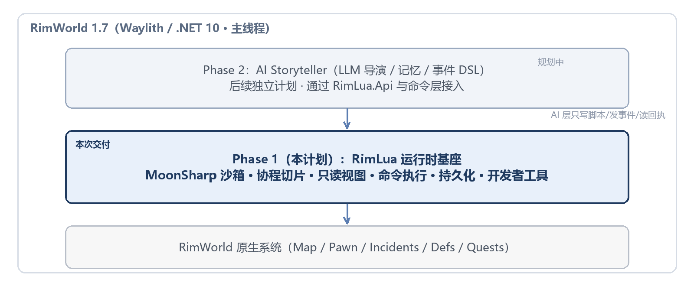
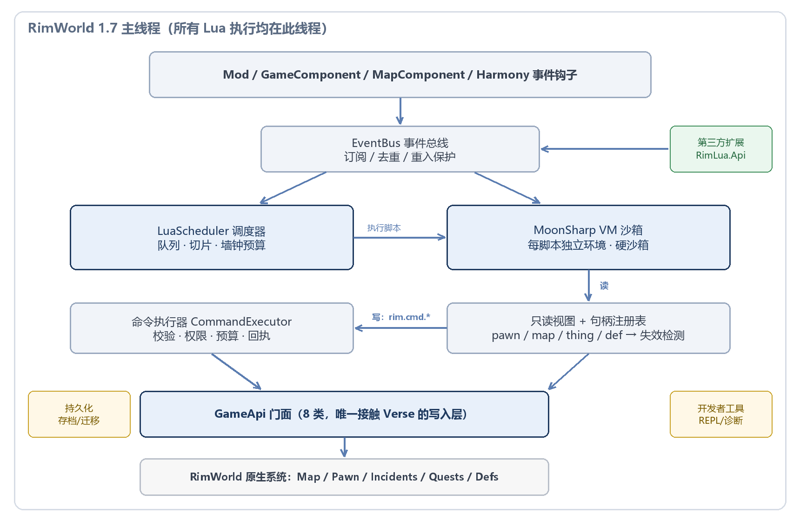

# RimLua 实现计划 v0.1

> 为 RimWorld 1.7 接入 MoonSharp Lua 解释器，并暴露版本化 C# API 层
> 状态：**已批准，M0 执行中（2026-11-16 开工）**　|　文档日期：2026-11-16　|　参考基线：《Stellaris AI Storyteller 开发指导 v0.1》

---

## 0. 一页纸摘要

**一句话**：RimLua 是一个独立 RimWorld 模组，内置 MoonSharp Lua 5.2 运行时、硬沙箱、执行预算、只读游戏视图、受控写入命令队列、存档持久化和开发者控制台，并为其他模组提供稳定的 C# 扩展 API。它同时也是你参考文档里 “M2 Lua Event Runtime” 的通用化前置实现——先把这个基座做对，AI 叙事层才有可靠的下层。

**本计划交付的东西**：

| 交付物 | 内容 | 验收方式 |
| --- | --- | --- |
| RimLua.dll | MoonSharp 宿主、沙箱、预算、事件总线、句柄注册表、命令执行器、持久化、控制台 | 游戏内加载不报错，恶意脚本被拦截 |
| 游戏 API 层 | 只读视图（game/map/pawn/thing/def/room）+ 首批 12 个写入命令 | 示例脚本可读取殖民地并安全改变世界 |
| 第三方扩展 API | `[LuaApi]` 注册、类型编解码、C# 调用 Lua、能力清单 | 示例扩展模组注册 3 个 API 并在脚本中调用 |
| 文档与样例 | API 参考、脚本示例、扩展示例、存档格式 | 文档与 API dump 一致 |

**规模判断**（单人，有 AI 辅助；人日按净投入计）：

| 范围 | 内容 | 预估 |
| --- | --- | --- |
| MVP | M0 可行性 + M1 沙箱内核 + M2 只读 API/事件 | 约 10–13 人日（2–3 周业余） |
| v1 完整版 | M0–M5（含写入命令、持久化、扩展 API） | 约 30–36 人日（5–7 周业余） |
| 发布级 | 再加 M6 硬化/性能/兼容/许可 | 约 36–42 人日 |

**四条核心结论**：

1. **技术上已做预研验证**：MoonSharp **3.0.0-beta.1**（netstandard2.0）已用 RimWorld 自带的 WaylithCLR（.NET 10.0.15）跑通脚本执行、协程切片与 UserData 互操作，实测约 **1.69 亿 VM 指令/秒**。尚未在游戏进程内验证加载与主线程集成——那正是 M0。
2. **沙箱策略要按 MoonSharp 的真实能力来设计**：它没有内置指令/内存预算，必须用“协程 + AutoYieldCounter + 墙钟”做切片；`Preset_HardSandbox` 很激进（连 `pcall`/`setmetatable` 都是 nil），需要按白名单逐项加回。
3. **安全上必须换思路**：参考文档的判断是对的——Lua 不能直接拿到 Pawn/Map 对象。RimLua 采用「只读视图 + 句柄 + 命令队列」，脚本永远不持有真实游戏对象引用。
4. **不要一口气做 AI**：RimLua 先只服务“本地可信脚本”。AI 生成的不可信脚本需要更强隔离（能力降级、甚至进程隔离），放到 Phase 2 再评估。

**范围调整（2026-11-16，用户决定）**：优先实现“任意子模组通过 RimLua 注册 Lua C# API”，**暂缓事件/定时器/持久化/控制台**。该能力已实现并通过游戏内验证，见 [Docs/EXTENSION_API.md](Docs/EXTENSION_API.md) 与 [Docs/M1-EXTENSION-API-REPORT.md](Docs/M1-EXTENSION-API-REPORT.md)。
>
> **2026-11-17 追加完成（仍不做事件）**：API 耗时/预算、脚本 state 持久化、游戏内控制台、C#→Lua 调用、API dump；验证见 [Docs/M2-PLATFORM-REPORT.md](Docs/M2-PLATFORM-REPORT.md)。

**需要你拍板的 8 件事**（详见 §13）：项目范围、信任模型、写入 API 风格、首版 API 深度、是否依赖 Harmony、目录与命名、发布目标、玩家脚本。

**当前状态（2026-11-16）**：用户已批准按建议推进，M0 已完成——游戏内 **27/27** 冒烟通过（MoonSharp 3.0.0.0、硬沙箱、切片中止、主线程、实时热加载），详见 [Docs/M0-REPORT.md](Docs/M0-REPORT.md)。下一步进入 M1（沙箱内核与控制台）。

---

## 1. 背景、现状与定位

### 1.1 参考文档给出的约束

你的《Stellaris AI Storyteller 开发指导 v0.1》已经把 Lua 运行时这一层想清楚了，RimLua 直接继承以下条款：

| 文档位置 | 原约束 | RimLua 如何落实 |
| --- | --- | --- |
| §5.1 运行时选型 | MoonSharp 2.x 稳定版，CoreModules.Preset_HardSandbox 起步，禁止 os/io/loadfile/require，禁止自动注册 CLR 类型 | §4.1–4.2 逐条实现并补测；版本建议调整为 3.0.0-beta.1（理由见 §4.1） |
| §5.2 强制规则 | 脚本只计算操作计划，不直接改世界；动作必须经过 Schema/语义/权限/预算/存在性检查 | §5.4 命令队列 + 逐条校验 |
| §5.2 预算建议 | 源码 ≤64 KiB、≤100,000 指令、≤32 动作、输出 ≤64 KiB、状态 ≤32 KiB | §4.3 作为默认值，M1 实测后调参 |
| §5.3 API 设计 | 动作带 type/opId/target/args/preconditions/onFailure；P0–P3 权限分层 | §5.2、§5.4 直接采用 |
| §6.3 执行语义 | 幂等、预条件、事务边界、失败补偿 | §5.4 命令执行器 |
| §10 安全与存档 | 不保存 VM/协程/Task；保存 schema、脚本哈希、状态、计时器 | §6.4 持久化设计 |
| §15.1 已定决议 | Lua 负责复杂逻辑，C# 通过白名单操作执行副作用 | 全局架构前提 |

**差异说明**：参考文档面向“特定事件脚本”设计（每个事件阶段一个 `Lua(source, ctx, state) -> {actions, next_state}`）。RimLua 面向“通用脚本平台”（事件钩子、定时器、REPL、第三方扩展）。两者不冲突：RimLua 后续可以加一个 `rim.plan` 模块来兼容文档里的动作计划协议，但 v1 不把它作为唯一模型。

### 1.2 本机环境事实（已核实）

| 项目 | 事实 | 对 RimLua 的影响 |
| --- | --- | --- |
| 游戏版本 | `1.7.5011 rev24`（`RimWorld/Version.txt`） | 只按 1.7 设计，不承诺 1.6 |
| 运行时 | `RimWorld.runtimeconfig.json`：`net10.0`，`Microsoft.NETCore.App 10.0.15-waylithclr.dev`；根目录有 `coreclr.dll`、`System.Private.CoreLib.dll`、`Waylith.dll`、`UnityStubs.dll` | 模组工程目标框架 **net10.0** |
| CLR 宽容开关 | `WaylithClr.LaxAssemblyBinding`、`SkipAccessChecks`、`IsolatedLoadsResolveByName` 等 | 反射/动态 IL 可行，但类型身份跨上下文有坑（§11 R1） |
| Harmony | 1.7 对应 **Harmony 3.x**（`0Harmony.dll` 3.0.0.0）；本机 `Mods/Harmony` 是旧的 2.4.2 副本，工作坊项 2009463077 才是新的 | About.xml 必须声明 `brrainz.harmony` 依赖，引用 3.x 且 `Private=false` |
| .NET SDK | 系统仅装 9.0.304；`PioneerFrameworkLite/.zcode/dotnet10/` 内有便携 SDK **10.0.402**（`global.json` 固定） | 构建用 10.0.402；建议 RimLua 自备/复用便携 SDK，并在 `global.json` 钉版本 |
| 既有 1.7 工程参考 | `PioneerFrameworkLite`（net10.0、SDK-style、`GameReferences.props`、输出到 `1.7/Assemblies/`） | 直接沿用其工程范式，但**不要**把 PFL 的旧游戏 DLL 当引用源（那是 1.7.4977，与当前 5011 不一致） |
| 工作目录 | `Mods/AIStory/`（M0 已搭出工程骨架；原为空目录） | 目录名是否改成 RimLua 见 §13 |

### 1.3 生态先例（说明这条路有人走过，但没有可复用代码）

| 先例 | 做法 | 结论 |
| --- | --- | --- |
| **MoonSpeak**（2017） | RimWorld + MoonSharp，Lua 里可 `require("Verse.Find")`、运行时用 Reflection.Emit 造 C# 类型、Harmony 打补丁、内置 REPL | 与本项目最接近；证明 MoonSharp 能在旧版 RimWorld 跑通，但它 1.x 时代、无预算/无持久化，代码不可直接复用 |
| **RimLua**（2017，作者 spdskatr） | 基于 **NLua** 的可编程 Lua 触发器 | **名字已被占用**；packageId 必须区分（见 §13）。NLua 有原生依赖，不适合本项目的 net10/Waylith 目标 |
| 2016 Ludeon 论坛提议 | 社区设想过“RimWorld 脚本层” | 说明需求长期存在，但没有成熟实现 |

结论：**架构可以借鉴，代码要从零写；名字要避让**。

### 1.4 RimLua 在整体架构中的位置



*图 1：Phase 2 的 AI 叙事层建立在 RimLua 运行时之上。*

RimLua 交付后，AI 层只需要：写 Lua 脚本 / 发事件 / 读执行回执，不用再碰 MoonSharp 与游戏 API 细节。其他模组也可以直接用 RimLua 写脚本，不必等 AI 功能——这能让项目先产生独立价值。

---

## 2. 目标与非目标

### 2.1 目标（每一条都可验收）

| 编号 | 目标 | 验收标准 |
| --- | --- | --- |
| G1 | 在 RimWorld 1.7 中安全运行 Lua 脚本 | 加载 mod 后执行 `return 1+1` 成功；错误脚本不导致游戏崩溃 |
| G2 | 硬沙箱：脚本无法访问文件/网络/进程/任意 CLR | 安全测试集全部被拒绝（§10） |
| G3 | 执行预算：无限循环、递归、超大分配会被中断 | 单次执行超限后 ≤50 ms 内回到游戏主循环 |
| G4 | 只读游戏视图 + 受控写入 | 脚本能枚举殖民地/Pawn/地图；写入只能通过命令且被校验 |
| G5 | 事件与定时器 | Pawn 死亡等 6 类事件可订阅；`after(ticks, fn)` 只触发一次 |
| G6 | 存读档可靠 | 存档-读档后脚本状态、定时器、禁用列表一致，无重复执行 |
| G7 | 第三方可扩展 | 另一个模组可注册 API 并在 Lua 中调用，无需改 RimLua 源码 |

### 2.2 非目标（v1 明确不做，避免范围失控）

| 编号 | 非目标 | 原因 |
| --- | --- | --- |
| N1 | 不做 LLM 接入、叙事导演、记忆系统 | 属于 Phase 2 |
| N2 | 不允许运行时编译 C# / 加载 DLL | 安全与存档风险，参考文档 §1.2 也禁止 |
| N3 | 不暴露任意 CLR 反射（`require("Verse.Find")` 这类） | MoonSpeak 的教训；不可版本化、不可审计 |
| N4 | 不做逐 Tick 的 Pawn 移动/战斗指令 | 参考文档 §8.3；行为应走 Job/Lord |
| N5 | 不支持多人模组（Zetrith Multiplayer） | Lua 状态同步语义未定义，明确列为不支持 |
| N6 | 不承诺跨 RimWorld 大版本兼容（1.6） | 1.7 net10 与 1.6 net472 二进制不兼容；双版本成本高 |
| N7 | 不把“脚本能力”做成任意文件 IO 的通用胶水层 | 如确需读写配置，走宿主提供的受限配置 API |
| N8 | 不为每个脚本建独立进程 | 进程隔离留到“不可信 AI 脚本”阶段评估 |

### 2.3 成功标准

- **可用**：第三方模组作者能按文档在 30 分钟内写出“每 2500 tick 发一封信”的脚本。
- **可信**：安全测试集 100% 拦截；连续运行 1 小时无内存增长、无主线程卡顿尖峰。
- **可维护**：游戏 API 全部收口在 8 个门面类内，换游戏大版本时不改 Lua 层。

---

## 3. 总体设计

### 3.1 五条架构原则

1. **主线程唯一**：Lua 只在游戏主线程执行；所有入口来自 `GameComponent`/`MapComponent` 回调或 Harmony 补丁。绝不在后台线程创建或调用脚本 VM。
2. **只读视图 + 命令写入**：Lua 拿到的是包装对象（视图），只能读；写操作一律变成命令，由 C# 校验并执行。
3. **默认拒绝**：沙箱从 `Preset_HardSandbox` 起步；每多开一个能力都要在代码里显式加白名单。
4. **状态可序列化**：VM、协程、委托、对象引用一律不入档；入档的只有纯数据状态、计时器、脚本哈希。
5. **错误隔离**：任何脚本错误都在边界内被捕获、记录、降级；不允许冒泡到游戏主循环。

### 3.2 架构图



*图 2：主线程内的脚本调度、只读视图、命令执行与扩展点。*

### 3.3 模块职责

| 模块 | 职责 | 关键类型（草案） |
| --- | --- | --- |
| `Bootstrap` | Mod 入口、Harmony 初始化、组件注册、配置读取 | `RimLuaMod`、`RimLuaBootstrap` |
| `Scripting/Repository` | 发现脚本、加载顺序、manifest 解析、哈希 | `LuaScriptRepository`、`LuaScriptDescriptor` |
| `Scripting/Host` | MoonSharp VM 生命周期、脚本环境隔离、加载/执行 | `LuaScriptHost`、`LuaScriptEnv` |
| `Scripting/Sandbox` | 模块白名单、全局表管控、危险函数拦截 | `LuaSandboxPolicy` |
| `Scripting/Budget` | 指令/时间/输出/内存预算，切片与强制终止 | `LuaBudget`、`LuaSliceRunner` |
| `Scripting/Scheduler` | 事件与定时器排队、每 tick 时间片、重入保护 | `LuaScheduler` |
| `Runtime/Handles` | 游戏对象 ↔ 稳定句柄；失效检测；解引用 | `LuaHandleRegistry`、`LuaHandleRef` |
| `Runtime/Views` | 只读包装：game/map/pawn/thing/def/room | `LuaGameView`、`LuaPawnView` 等 |
| `Runtime/Commands` | 命令注册、校验、权限、执行、补偿 | `LuaCommandRegistry`、`LuaCommandExecutor` |
| `Runtime/GameApi` | 把命令变成原生调用（唯一碰 Verse 的写入层） | `IGameActionHandler` 实现集合 |
| `Runtime/Events` | 事件定义、Harmony 钩子、C# 侧订阅 | `LuaEventBus`、`LuaEventHooks` |
| `Persistence` | GameComponent 存档、迁移、脚本状态 | `RimLuaGameComponent` |
| `PublicApi` | 给其他模组的稳定 API、属性、注册表、编解码 | `LuaApiRegistry`、`[LuaApi]` |
| `DevTools` | REPL、错误面板、性能面板、API dump | `Window_LuaConsole`、`LuaDebugTab` |

### 3.4 一次脚本执行的端到端流程

1. 触发源（事件/定时器/控制台命令/存档加载）进入 `LuaScheduler`，压入队列。
2. 主线程安全点（`GameComponentTick` 或事件回调末尾）取出任务；若正在执行 Lua 则只排队（重入保护）。
3. `LuaScriptHost` 为该脚本设置独立环境表与预算，**把编译好的 chunk 包成协程**，按切片推进。
4. 脚本读：通过 `LuaGameView` 得到视图/句柄；读操作立即返回纯数据或视图对象。
5. 脚本写：调用 `rim.cmd.*`；命令**逐条校验并立即执行**（默认模式），返回回执；计划模式（Phase 2）才入队批处理。
6. 脚本返回/出错/超预算：`LuaScriptHost` 关闭本次执行，记录指令数、切片数、耗时、错误。
7. 执行结果与脚本状态交回 `Persistence` / `EventBus`，产生后续事件（如 `script_error`）。

### 3.5 线程、重入与安全点

- **允许执行 Lua 的位置**：`GameComponentTick`、`GameComponentUpdate`（仅控制台）、`MapComponentTick`、Harmony 补丁的“事后”位置（Pawn 死亡、事件结束等）、存档加载完成回调。
- **禁止执行 Lua 的位置**：Def 加载期间、World/Map 生成中途、绘制回调、后台线程、`Scribe` 读写回调内部。
- **重入保护**：`LuaScheduler.IsExecuting` 为真时，新事件只入队；队列长度上限（默认 256），超出丢弃并记警告。
- **写入安全点**：命令只在“脚本正在安全点执行”时被允许；脚本外（后台、绘制、Scribe）调用命令直接报错。
- **切片**：单次脚本不是一口气跑完，而是按 `AutoYieldCounter` + 墙钟切片；跨 tick 的长脚本保持挂起状态（但**不**把挂起协程写入存档，见 §6.4）。

---

## 4. Lua 运行时与沙箱

### 4.1 MoonSharp 选型与版本策略

| 项 | 结论 |
| --- | --- |
| 运行时 | MoonSharp（纯 C#，Lua 5.2 语义），BSD-3-Clause |
| 可用包 | NuGet `MoonSharp` **2.0.0**（2016）：`net35-client / net40-client / netcore / netstandard1.6 / portable`；`3.0.0-beta.1`（2026）：`net45 / netstandard2.0` |
| 建议 | 钉 **3.0.0-beta.1 的 netstandard2.0 构建**：它已用 RimWorld 自带 WaylithCLR 实测通过（见 §16.2），且 netstandard2.0 在 net10.0 上比 netstandard1.6 更稳。属于 beta，风险由 M0 兜底；万一出问题可回退 2.0.0 的 netstandard1.6 构建 |
| 备选 | WattleScript（MoonSharp 的 BSD-3 分支，带 netstandard2.0+ 与 AOT 支持），仅在 MoonSharp 出现无法绕过的问题时评估 |
| 许可 | 随包附 `Licenses/MoonSharp-BSD-3-Clause.txt`（含 KopiLua 等第三方声明），README 注明版权；不暗示原作者背书 |
| 分发 | 不走 NuGet 运行时还原，直接提交 DLL（与 RimWorld 模组惯例一致），构建脚本校验 SHA256 |
| 冲突规避 | 启动时检查 `AppDomain.CurrentDomain.GetAssemblies()` 是否已有 `MoonSharp.Interpreter`；版本不同则记录并禁用 RimLua 脚本（避免类型身份冲突） |

**M0 必须在游戏进程内验证的 5 件事**（预研已覆盖第 2–3 项，但要在游戏里复测）：

1. `MoonSharp.Interpreter.dll` 能否被游戏加载并完成类型解析（放在 `1.7/Assemblies/`，由游戏加载器发现）。
2. `new Script(CoreModules.Preset_HardSandbox)` 能否执行 `return 1+2`；`os/io/require/loadfile` 是否为 nil。
3. 协程切片：`AutoYieldCounter` + `Resume()` 能否让 `while true do end` 在成本上限内让出，并能继续/终止。
4. 解析成本：64 KiB 源码 `LoadString` 的耗时（应放在加载期，不进 tick）。
5. 主线程/生命周期：在 `GameComponentTick` 内执行不报错；反复读档、进出地图后无泄漏、无失效对象访问。

### 4.2 沙箱配置清单

| 项 | 设置 | 说明 |
| --- | --- | --- |
| 核心模块 | `CoreModules.Preset_HardSandbox`（0x056B：GlobalConsts/TableIterators/String/Table/Basic/Math/Bit32） | 已实测：`io/os/require/load/dofile/pcall/setmetatable/coroutine` 均为 nil |
| 选择性加回 | `ErrorHandling`（`pcall/xpcall/error/assert`）与 `Metatables`（`setmetatable/getmetatable`） | 脚本作者的基本诉求；不引入 IO/OS/Debug/Dynamic。`coroutine` 仍不暴露（切片由宿主协程完成，脚本无需自建协程） |
| 关闭 | `IO`、`OS_Time`、`OS_System`、`Dynamic`、`Json`（由宿主提供 JSON）、`Debug`、`LoadMethods` | 逐项断言测试；`json` 只暴露宿主的纯数据编解码 |
| 全局表 | 每个脚本独立环境表；只注入 `rim`、`log`、`json`、`state` 等约定全局 | 禁止脚本互相污染 |
| `require` | 自实现：只允许加载本脚本所属 mod 的 `Lua/` 目录内文件；禁止绝对路径与 `..` 逃逸；缓存并统计大小 | 原生 require 必须禁用 |
| CLR 类型 | 禁止 `UserData.RegisterType` 任意类型；只注册 RimLua 自己的视图包装类 | 白名单在代码中硬编码 |
| 字符串 | 单次执行创建字符串总量 ≤ 4 MiB（估算）；单字符串 ≤ 64 KiB | 通过宿主 API 检查或事后统计 |
| 表/递归 | 序列化/转换深度 ≤ 32；递归调用深度 ≤ 64（宿主侧计数） | 防止爆栈与序列化炸弹 |
| 输出 | 脚本返回/写入状态 ≤ 64 KiB（与参考文档一致） | JSON 编码后计量 |
| 线程 | `ScriptOptions.CheckThreadAccess = true`；一个 `Script` 只在主线程使用 | 防止后台误用 |

### 4.3 预算与强制中断（切片模型）

MoonSharp **没有内置指令预算或中止 API**（2.0.0/3.0.0-beta.1 都没有 `InstructionBudget`/`MemoryLimit`/`Timeout`）。可行的做法是**协程切片**：

```csharp
// 预研已验证的切片模式（伪代码）
var script = new Script(CoreModules.Preset_HardSandbox | CoreModules.ErrorHandling | CoreModules.Metatables);
Script.WarmUp();                                   // 约 10 ms，每进程一次
var chunk  = script.LoadString(code, null, scriptId);  // 解析（加载期完成，不进 tick）
var co     = script.CreateCoroutine(chunk).Coroutine;
co.AutoYieldCounter = 5000;                        // 每 5000 条 VM 指令让出一次（约 60 微秒）

var sw = Stopwatch.StartNew();
DynValue r;
do {
    r = co.Resume();                               // 续跑一片
} while (r.Type == DataType.YieldRequest && sw.ElapsedMilliseconds < budgetMs);

if (r.Type == DataType.YieldRequest) {
    // 墙钟/总指令超限：不再续跑，标记本次失败，丢弃本脚本挂起协程
    budget.Abort();
}
```

**关键约束（预研结论）**：

1. `AutoYieldCounter` 只在“从 CLR 恢复的协程”里生效——**绝不能用 `DoString` 直接跑不可信代码**。
2. 协程被强制挂起后，下一次 `Resume` 不能带参数（否则 `ArgumentException`）。
3. 解析是同步不可切片的：20 KB 约 4.6 ms、200 KB 约 118 ms——所以源码大小上限 64 KiB，且解析放在加载期。
4. 切片是协作式的，不会抛可被 `pcall` 捕获的异常，因此不存在“脚本吞掉中止”的问题；“超限”表现为停止续跑并丢弃协程。

| 预算 | 默认值（可配置） | 触发后行为 |
| --- | --- | --- |
| 每片指令数 | 5,000（约 60 微秒） | 让出，等待下一片 |
| 单次墙钟 | 事件脚本 100 ms；每 tick 脚本 5 ms（硬上限 50 ms） | 停止续跑，本次失败，丢弃协程 |
| 单次总指令 | 事件 1,000,000；每 tick 100,000 | 停止续跑并记录 |
| 单次命令数 | 32 | 第 33 条命令直接拒绝 |
| 输出/状态大小 | 64 KiB | 拒绝写回 |
| 每 tick 总预算 | 默认 2 ms（可配） | 未执行完的任务顺延到下一 tick |
| 连续失败 | 5 次 | 自动禁用该脚本，控制台/日志提示，设置页可恢复 |

### 4.4 错误与降级

| 错误类型 | 处理 |
| --- | --- |
| 编译错误 | 记录脚本名 + 行号 + 消息；脚本不加载；不阻塞其他脚本 |
| 运行时错误 | 捕获并记录；脚本继续可用（计入失败计数） |
| 预算中止 | 同运行时错误，但额外记录指令数/切片数/耗时 |
| 宿主 API 错误（参数非法等） | 转成 Lua error，带可读消息，脚本可 `pcall`；同时记 debug 日志 |
| 脚本加载冲突（同名 API） | 明确报错并保留先注册者；文档要求命名空间前缀 |
| 连续失败 | 自动禁用脚本，写存档；控制台可手动恢复 |

### 4.5 性能目标（预研实测已给出基线）

| 指标 | 预研实测 | 工程目标 |
| --- | --- | --- |
| VM 吞吐 | 约 169M 指令/秒（约 5.9 ns/指令） | ≥ 50M 指令/秒（留余量） |
| 单片成本 | 5,000 指令约 60 微秒 | 每 tick 总 Lua ≤ 2 ms |
| 解析 | 20 KB 约 4.6 ms；200 KB 约 118 ms | 源码 ≤64 KiB，加载期解析 |
| 冷启动 | `Script.WarmUp()` 约 10 ms | 只在加载期支付 |
| 空载开销（无事件/无定时器） | 预研未测 | < 0.1 ms/tick |
| 1 小时运行 | 预研未测 | 托管内存无持续增长（±10%） |
| 存档体积增量 | 预研未测 | 每脚本状态 ≤ 32 KiB；总增量 ≤ 512 KiB |

> 说明：预研已证明“性能不是瓶颈”，真正的工程点是切片调度、解析时机、内存/状态配额和游戏内集成。

---

## 5. Lua ↔ C# API 设计

### 5.1 设计原则

1. **命名空间化**：所有 API 挂在 `rim` 下，第三方扩展必须用 `rim.<modId>.*`，避免污染全局。
2. **版本化**：`rim.api_version` 暴露整数版本；新增只加不改，废弃先警告后移除。
3. **能力声明**：每个脚本声明自己需要的能力（读快照/写命令/发事件/定时器），宿主按清单授权。
4. **不暴露反射**：不用 `require("Verse.Find")`，不自动注册 CLR 类型；只暴露手写的视图包装类。
5. **错误即数据**：C# 侧异常转成带脚本行号的 Lua error；Lua 侧错误回传为结构化结果，不吞掉。

### 5.2 Lua 侧 API 总览

```lua
-- 一个完整脚本示例
rim.event.on("game_loaded", function()
  rim.log.info("RimLua 已就绪，版本 %s", rim.version)
  rim.timer.every(2500, function()
    local n = #rim.game.colonists()
    rim.cmd.letter.send("殖民地日报", string.format("当前殖民者：%d 人", n))
  end)
end)

rim.event.on("pawn_death", function(e)
  local p = rim.pawn.get(e.pawn)
  if p and p:is_colonist() then
    rim.log.warn("殖民者死亡：%s", p:name())
    rim.cmd.message("殖民地失去了一位成员", { type = "negative" })
  end
end)
```

| 命名空间 | 内容 | 读写 | 优先级 |
| --- | --- | --- | --- |
| `rim` | `version`、`api_version`、`capabilities`、`log`、`json`、`util` | 只读/工具 | P0 |
| `rim.event` | `on(name, fn)`、`off(name, fn)`、`once(name, fn)`、`list()` | 只读事件 | P0 |
| `rim.timer` | `after(ticks, fn)`、`every(ticks, fn)`、`cancel(id)`、`now()` | 只读调度 | P0 |
| `rim.game` | `ticks()`、`day()`、`hour()`、`weather()`、`difficulty()`、`colonists()`、`all_pawns()`、`current_map()`、`is_paused()` | 只读 | P0 |
| `rim.map` | `current()`、`list()`、`size()`、`terrain_at(cell)`、`things_at(cell)`、`temperature_at(cell)`、`is_home(cell)`、`room_at(cell)` | 只读 | P0/P1 |
| `rim.pawn` | `get(handle)`、`find(name)`、`needs(h)`、`health(h)`、`skills(h)`、`traits(h)`、`equipment(h)` | 只读 | P0/P1 |
| `rim.thing` | `get(handle)`、`def_name(h)`、`stack(h)`、`position(h)`、`on_map(h)` | 只读 | P1 |
| `rim.defs` | `get(category, defName)`、`all(category)`、`exists(...)`、`categories()` | 只读 | P0 |
| `rim.cmd` | 受控写入命令（见 §5.4） | 写 | P0/P1 |
| `rim.plan` | 动作计划模式（兼容参考文档的 actions/next_state） | 写 | Phase 2 |
| `rim.<modId>` | 第三方扩展注册的命名空间 | 视扩展 | P1 |
| `state` | 当前脚本的持久状态表（纯数据，自动入档） | 读写 | P0 |
| `log` | `info/debug/warn/error` 的别名 | 工具 | P0 |

**关键取舍**：不提供 `rim.game.set_xxx` 这类直接写属性。所有写操作统一走 `rim.cmd.*`，这样可以集中做权限、预算、目标校验与日志，也让 Phase 2 的 AI 审计变得可能。

### 5.3 句柄与视图模型

Lua 不持有真实 `Pawn`/`Map`/`Thing` 引用，只持有一个**包装对象**（MoonSharp UserData）：

```text
Lua 侧:  p = rim.pawn.get(h)     -- h 是句柄（不透明，可跨调用传递）
         p:name()                 -- 只读方法，内部解引用 + 有效性检查
         p:valid()                -- false 表示对象已失效（地图卸载/死亡/销毁）
```

| 规则 | 说明 |
| --- | --- |
| 句柄结构 | `{ kind = "pawn", id = 12345 }`，由宿主生成与校验；脚本不得伪造 |
| 失效检测 | 视图方法执行前检查对象是否仍被游戏持有；失效时抛 `stale handle` 错误 |
| 跨存档 | 句柄本身不入档。持久引用请存字符串键（如 `rim.pawn.uid(h)` 或 `defName + name`），读档后重新解析 |
| 生命周期 | 读档/切换地图后，旧视图全部失效；脚本在 `on_game_loaded`/`on_map_loaded` 中重建引用 |
| 防泄漏 | 视图只做只读包装，不保存静态强引用；句柄注册表用弱引用/显式回收 |

**为什么不用纯表快照**：纯表简单但会复制大量数据（每 tick 分配）、且无法表达“实时查询”。视图对象零拷贝、可校验失效，更适合长期运行。

### 5.4 写入命令模型

命令 = 一次受控副作用。每个命令必须声明类型、目标、参数，由 C# 校验后执行，并返回回执。

```lua
-- 默认：同步校验 + 立即执行 + 返回回执
local r = rim.cmd.thing.spawn{ def = "Steel", count = 10, cell = { x = 100, z = 120 } }
if not r.ok then rim.log.warn("生成失败：%s", r.error) end

-- 计划模式（Phase 2）：命令入队，批次校验后统一执行
rim.plan.submit{ { type = "thing.spawn", ... }, { type = "letter.send", ... } }
```

| 阶段 | 内容 |
| --- | --- |
| 解析 | Lua 参数 → `LuaCommand`（类型、target、args、opId） |
| 校验 | 类型/范围/枚举值存在性、Def 是否存在、目标句柄是否有效、权限、预算、前置条件 |
| 执行 | 调用对应的 `IGameActionHandler`，只在此层碰 Verse API |
| 回执 | `{ ok = true, id = 123 }` 或 `{ ok = false, error = "..." }` |
| 失败 | 单条命令失败不影响已执行命令（RimWorld 无通用回滚）；计划模式下批次校验先行，降低部分执行概率 |

**首批写入命令（v1 范围）**：

| 命令 | 权限 | 说明 | 状态 |
| --- | --- | --- | --- |
| `rim.cmd.letter.send(title, text, opts)` | P0 | 发信件（LetterDef 可选） | 必做 |
| `rim.cmd.message(text, opts)` | P0 | 顶部消息提示 | 必做 |
| `rim.cmd.thing.spawn{def,count,cell,map}` | P1 | 生成物品（数量/质量受预算） | 必做 |
| `rim.cmd.thing.destroy(handle)` | P1 | 销毁物品（仅非玩家关键对象） | 必做 |
| `rim.cmd.pawn.spawn{kind,faction,cell,map}` | P1 | 生成 Pawn（原生 PawnGenerator 后处理） | 必做 |
| `rim.cmd.pawn.damage(handle, amount, damageDef)` | P1 | 造成伤害（可追踪） | 必做 |
| `rim.cmd.pawn.heal(handle, amount)` | P1 | 治疗 | 必做 |
| `rim.cmd.pawn.set_need(handle, need, value)` | P1 | 调整需求（饥饿/休息） | 必做 |
| `rim.cmd.pawn.add_thought(handle, thoughtDef, mood)` | P1 | 添加心情/想法 | 必做 |
| `rim.cmd.incident.fire(defName, mapId, target)` | P1 | 触发原生 Incident | 必做 |
| `rim.cmd.weather.set(mapId, weatherDef)` | P1 | 改变天气 | 必做 |
| `rim.cmd.terrain.set(mapId, cell, terrainDef)` | P1 | 改变地形（需校验玩家建筑） | 必做 |
| `rim.cmd.research.add(projectDef, amount)` | P1 | 推进研究 | 建议 |
| `rim.cmd.faction.change_relation(faction, amount)` | P2 | 派系关系 | 延后 |
| `rim.cmd.quest.create(...)` | P2 | 任务生成 | 延后 |
| `rim.cmd.mapgen.generate(...)` | P3 | 地图生成/Site | Phase 2 |

**为什么不做跨命令事务**：RimWorld 的副作用（生成 Pawn、触发袭击）没有通用回滚接口；参考文档 §6.3 也承认这点。v1 采用“逐条校验、失败即停、如实回执”，并在计划模式里做全量预校验以降低半执行概率。

### 5.5 C# 侧扩展 API（给其他模组用）

```csharp
using RimLua.Api;

[LuaModule("mymod")]
public static class MyModLuaApi
{
    [LuaFunction("greet")]
    public static string Greet(string name) => "你好，" + name;

    [LuaFunction("spawn_ore")]
    public static LuaCommandResult SpawnOre(string defName, int count, IntVec3 cell)
    {
        // 扩展作者可以直接复用 RimLua 的命令校验/预算，或实现自己的逻辑
        return RimLuaApi.ExecuteCommand("thing.spawn", new { def = defName, count, cell });
    }
}

// 在 [StaticConstructorOnStartup] 或 Mod 构造里注册（RimLua 加载后）
RimLuaApi.RegisterModule(typeof(MyModLuaApi));
RimLuaApi.RegisterGlobal("mymod.version", "1.0.0");
```

| API | 用途 |
| --- | --- |
| `RimLuaApi.RegisterModule(Type)` | 扫描 `[LuaModule]` 类并注册 `[LuaFunction]` 方法 |
| `RimLuaApi.RegisterFunction(string path, Delegate fn)` | 手动注册单个函数 |
| `RimLuaApi.RegisterGlobal(string path, object value)` | 注册常量/数据 |
| `RimLuaApi.ExecuteCommand(string type, object args)` | 走 RimLua 的命令校验与执行管线 |
| `RimLuaApi.Events.GameLoaded/MapLoaded/ScriptError` | C# 侧订阅生命周期 |
| `RimLuaApi.CallFunction(string scriptId, string fn, params object[] args)` | C# 主动调用某个脚本的函数（带预算与异常保护） |
| `RimLuaApi.TryGetScript(string id, out LuaScriptInfo)` | 查询脚本状态/禁用原因 |
| `RimLuaApi.ApiVersion` | 版本协商（扩展声明所需最低版本） |

**类型编解码规则**：

| C# 类型 | Lua 表现 | 说明 |
| --- | --- | --- |
| `int/long/float/double/bool/string` | 对应原生类型 | 数值范围校验；NaN/Inf 拒绝 |
| `IntVec3` | `{ x, z }` 表 | 只接受整数；越界拒绝 |
| `Def` | `defName` 字符串 | 运行时解析；不存在则报错 |
| `Pawn/Thing/Map` | RimLua 视图 UserData | 不接受原始 CLR 对象 |
| `IEnumerable<T>` | Lua 数组 | 最多 1000 项（防滥用） |
| `IDictionary<string,T>` | Lua 表 | 键必须字符串 |
| `null` | `nil` | 仅可空参数允许 |

### 5.6 C# → Lua 调用

- 事件回调：宿主通过 `LuaEventBus` 调用脚本注册的函数；失败只影响该订阅者。
- 主动调用：`RimLuaApi.CallFunction` 用于扩展模组/后续 AI 层；同样走预算与错误隔离。
- 回调签名统一为 `function(ctx) return result end`，`ctx` 包含 `event`、`data`、`script`、`tick` 等字段，纯数据。

### 5.7 API 兼容与演进

- 公共 API 命名空间：`RimLua.Api`；内部实现 `RimLua.Internal` 不承诺兼容。
- `rim.api_version` 单调递增；扩展在 `About.xml` 里写最低版本。
- 废弃流程：文档标注 → 运行时警告 1 个版本 → 移除。
- 文档生成：`tools/api-dump` 从属性/注册表导出 Markdown，CI 对比防止漂移。

---

## 6. 脚本加载、生命周期与持久化

### 6.1 脚本来源与加载顺序

| 来源 | 路径 | 说明 |
| --- | --- | --- |
| 内置库 | `1.7/Lua/core/*.lua`（RimLua 自身） | 只读；提供 `rim.util` 等；不可被覆盖 |
| 模组脚本 | `<任意Mod>/Lua/**/*.lua` | 自动发现；按 mod 加载顺序 + 文件名字典序执行 |
| 版本化脚本 | `<任意Mod>/1.7/Lua/**/*.lua` | 存在时优先于根 `Lua/`（沿用 LoadFolders 思路） |
| 玩家本地脚本 | `Config/RimLua/scripts/*.lua` | 可选（默认关闭）；仅开发者模式启用 |

**约定**：

- 每个 mod 的 `Lua/init.lua` 最先执行；其余 `.lua` 按路径排序执行（便于固定顺序）。
- `require("本mod相对路径")` 只在本 mod 的 `Lua/` 内解析；缓存编译结果。
- 脚本 ID 规则：`<packageId>/<相对路径>`，用于日志、禁用列表和存档。
- 同名模块/重复注册：保留先注册者并报错，文档要求扩展使用 `rim.<modId>` 前缀。

### 6.2 生命周期与事件

| 时机 | 行为 |
| --- | --- |
| 游戏启动、Defs 加载后 | 创建 `LuaScriptHost`，加载脚本，触发 `script_loaded` |
| 存档加载完成 | 恢复脚本状态与定时器，触发 `game_loaded`、`map_loaded` |
| 进入/切换地图 | 触发 `map_loaded`/`map_unloaded` |
| 每 tick | `LuaScheduler` 执行到期定时器与待处理事件（有预算） |
| 存档前 | 触发 `on_save`（只允许同步、轻量） |
| 退出游戏 | 触发 `on_shutdown`，取消定时器 |

**首版事件清单（Harmony 钩子不超过 6 个）**：

| 事件名 | 触发点 | 用途 |
| --- | --- | --- |
| `game_loaded` | GameComponent 初始化完成 | 初始化脚本状态 |
| `map_loaded` / `map_unloaded` | MapComponent 生命周期 | 地图级脚本 |
| `pawn_death` | `Pawn.Kill` 后置 | 叙事/统计 |
| `incident_fired` | `IncidentWorker.TryExecute` 后置 | 剧情联动 |
| `letter_sent` | `Find.LetterStack.ReceiveLetter` 后置 | UI/剧情 |
| `tick` | GameComponentTick（可选节流） | 兜底定时 |

> 原则：能不用 Harmony 就不用；能用 GameComponent 回调就不用补丁；每个补丁必须有注释说明原因与兼容风险。

### 6.3 生命周期集成点（1.7 注意）

| 集成点 | 用途 | 注意 |
| --- | --- | --- |
| `Verse.Mod` 子类 | 入口、配置、日志 | 构造早于 Defs 加载，不要在此执行脚本 |
| `[StaticConstructorOnStartup]` | 一次性初始化 | **1.7 里用它修改 Def 字段不生效**（PFL 实测结论）；本 mod 只用于注册，不改 Def |
| `GameComponent` | 全局状态、tick 泵、存档 | 用 `GameComponentTick` 而不是 `Update` 做脚本调度 |
| `MapComponent` | 地图级事件、地图脚本上下文 | 地图卸载时要失效句柄 |
| Harmony 3.x | 事件钩子 | 只在必要处打补丁；声明依赖；避免 transpiler |
| `ModSettings` | 预算、开发模式、脚本开关 | 配置独立于存档，但禁用列表要入档 |

### 6.4 存档结构

```json
{
  "schemaVersion": 1,
  "modVersion": "1.0.0",
  "scripts": [
    { "id": "mymod/init.lua", "hash": "sha256:...", "enabled": true,
      "state": { "day": 12, "flags": { "intro_done": true } },
      "failures": 0 }
  ],
  "timers": [
    { "script": "mymod/init.lua", "callback": "daily_report", "dueTick": 125000, "repeat": 2500, "args": null }
  ]
}
```

| 规则 | 说明 |
| --- | --- |
| 不存 VM/协程/委托/对象引用 | 读档后重建 VM，重新加载脚本 |
| 脚本哈希 | 检测脚本是否被更新；变化时记录并触发迁移钩子 |
| 状态大小 | 单脚本 ≤ 32 KiB；超出截断并警告 |
| 迁移 | `schemaVersion` + 每脚本可选 `stateVersion`；迁移函数失败则禁用该脚本并保留原数据 |
| 失败隔离 | 单个脚本状态损坏不影响其他脚本与游戏 |
| 禁用列表 | 连续失败自动禁用，写入存档，玩家可在设置中恢复 |

### 6.5 热重载与版本变更

- 开发模式启用 `rim.reload()` 与控制台命令；重载单个脚本：取消其定时器、保留/重置状态可选。
- 发布版默认关闭热重载，避免玩家误操作导致状态错乱。
- 脚本更新导致哈希变化：默认保留状态（若 `stateVersion` 未变），否则调用迁移或重置。

### 6.6 实时脚本与热加载（D8=B）

用户决定：允许 `Config/RimLua/scripts` 下的玩家本地脚本，并要求**实时性**——脚本文件在游戏运行中被写入/修改后应尽快生效，而不是重启游戏。

M0 已实现的基线：

| 项 | M0 行为 |
| --- | --- |
| 目录 | `<Config>/RimLua/scripts/*.lua`（自动创建；首次运行生成 `00_hello.lua` 样例） |
| 监听 | `FileSystemWatcher`（Changed/Created/Renamed），只入队 |
| 去抖 | 250 ms（同一次保存的多次事件合并） |
| 执行时机 | 下一 Tick 的 `GameComponentTick`（主线程），受指令/墙钟预算限制 |
| 错误处理 | 单个脚本失败只记日志，不影响其他脚本与游戏 |
| 手动控制 | M1 起在控制台提供 `reload` / `reload-all` / 脚本列表 |

M1+ 计划：

- 控制台内嵌编辑器（在游戏里直接写/改/运行脚本），保存即执行。
- 脚本级状态保留策略（重载时保留/重置 `state` 可选）。
- 脚本权限档（本地可信 / 动态不可信），热加载脚本默认走“本地可信”档。
- 变更审计：记录文件哈希、加载时间、失败次数，写入 `smoke-report`/日志。

> 安全提示：实时加载意味着**任何能写该目录的程序都能让游戏执行 Lua**。v1 仅对本地可信脚本启用；AI/远程脚本不得直接落到该目录，必须走 Phase 2 的能力降级与审核通道。

---

## 7. 开发者工具

| 工具 | 内容 | 交付阶段 |
| --- | --- | --- |
| Lua 控制台 | 开发者菜单入口；REPL；`rim.*` 自动补全；错误/历史 | M1 |
| 脚本管理面板 | 脚本列表、启用/禁用、失败次数、最后错误、手动重载 | M1/M4 |
| 性能面板 | 每 tick Lua 耗时、指令数、脚本热度 Top10 | M2 |
| API dump | 导出 `rim.*` 与扩展 API 清单（Markdown） | M5 |
| 事件日志 | 事件名、订阅者、耗时、异常 | M2 |
| 示例脚本库 | 3 个可运行样例（日报/死亡通知/事件链） | M2/M3 |

控制台只对开发者模式开放；发布版可通过设置页显式开启。

---

## 8. 工程结构与构建

```text
AIStory/ 或 RimLua/                ← 目录名待定（§13）
  About/
    About.xml                      ← packageId、supportedVersions 1.7、Harmony 依赖
    Preview.png
  LoadFolders.xml                  ← 1.7 版本化加载（可选，单版本可省）
  1.7/
    Assemblies/
      RimLua.dll
      MoonSharp.Interpreter.dll
    Lua/core/                      ← 内置核心库（rim.util 等）
    Languages/ChineseSimplified/Keyed/RimLua.xml
  Licenses/
    MoonSharp-BSD-3-Clause.txt
    THIRD_PARTY_NOTICES.md
  Source/
    RimLua/                        ← net10.0 主工程
      RimLua.csproj
      Bootstrap/ Scripting/ Runtime/ Persistence/ PublicApi/ DevTools/
    RimLua.Pure/                   ← 纯逻辑（无 Verse 依赖），供测试
    RimLua.Tests/                  ← xUnit（net10.0），纯逻辑 + 游戏 DLL 引用测试
  tools/
    rebuild-dll.ps1                ← Release 构建 + 复制到 1.7/Assemblies
    check-committed-dll.ps1        ← 校验提交的 DLL 与源码一致
    api-dump/                      ← 生成 API 文档
  global.json                      ← SDK 10.0.402（rollForward disable）
  Docs/
    API.md  SCRIPTING.md  SAVE_FORMAT.md  SECURITY.md  EXAMPLES/
  README.md
```

**csproj 关键点**（与 PFL 已验证的 1.7 范式一致）：

```xml
<Project Sdk="Microsoft.NET.Sdk">
  <PropertyGroup>
    <TargetFramework>net10.0</TargetFramework>
    <LangVersion>latest</LangVersion>
    <Nullable>enable</Nullable>
    <AssemblyName>RimLua</AssemblyName>
    <RootNamespace>RimLua</RootNamespace>
    <AppendTargetFrameworkToOutputPath>false</AppendTargetFrameworkToOutputPath>
    <OutputPath Condition="&apos;$(Configuration)&apos; == &apos;Release&apos;">..\..\1.7\Assemblies\</OutputPath>
    <GenerateDependencyFile>false</GenerateDependencyFile>
  </PropertyGroup>
  <ItemGroup>
    <!-- 游戏引用：Private=false，运行时由游戏提供；路径用环境变量/相对路径，禁止写死本机绝对路径 -->
    <Reference Include="Assembly-CSharp"><HintPath>$(GameDir)/Assembly-CSharp.dll</HintPath><Private>false</Private></Reference>
    <Reference Include="UnityStubs"><HintPath>$(GameDir)/UnityStubs.dll</HintPath><Private>false</Private></Reference>
    <Reference Include="Waylith"><HintPath>$(GameDir)/Waylith.dll</HintPath><Private>false</Private></Reference>
    <Reference Include="0Harmony"><HintPath>$(HarmonyDir)/0Harmony.dll</HintPath><Private>false</Private></Reference>
    <!-- 唯一随包分发的第三方 DLL -->
    <Reference Include="MoonSharp.Interpreter"><HintPath>..\..\ThirdParty\MoonSharp\MoonSharp.Interpreter.dll</HintPath><Private>true</Private></Reference>
  </ItemGroup>
</Project>
```

**构建**：

```powershell
$env:DOTNET_ROOT = "<repo>/.zcode/dotnet10"
$env:PATH = "$env:DOTNET_ROOT;$env:PATH"
$env:DOTNET_CLI_HOME = "<repo>/.zcode/cli-home"
dotnet build Source/RimLua/RimLua.csproj -c Release
```

> 本机已确认：系统 dotnet 只有 9.0.304，无法编译 net10.0；便携 SDK 10.0.402 可用。仓库应自带或文档说明获取方式，`global.json` 钉版本，避免换机器编不过。

**About.xml 草案**：

```xml
<?xml version="1.0" encoding="utf-8"?>
<ModMetaData>
  <name>RimLua</name>
  <author>Feng</author>
  <packageId>Feng.RimLua</packageId>
  <supportedVersions><li>1.7</li></supportedVersions>
  <modDependencies>
    <li>
      <packageId>brrainz.harmony</packageId>
      <displayName>Harmony</displayName>
      <steamWorkshopUrl>steam://url/CommunityFilePage/2009463077</steamWorkshopUrl>
      <downloadUrl>https://github.com/pardeike/HarmonyRimWorld/releases/latest</downloadUrl>
    </li>
  </modDependencies>
  <description>为 RimWorld 提供 Lua 脚本运行时与 C# 扩展 API。</description>
</ModMetaData>
```

---

## 9. 里程碑、验收与排期

### 9.1 里程碑总表

| 阶段 | 任务 | 交付物 | 验收标准 | 人日 |
| --- | --- | --- | --- | --- |
| **M0** 可行性 ✅ | SDK-style 工程、引用、加载 mod、MoonSharp 物理集成（5 项） | 能加载的空壳 mod + `Docs/M0-REPORT.md` | 游戏内 27/27 冒烟通过（2026-11-16） | 2–3（实际约 2.5） |
| **M1** 沙箱内核 | ScriptHost、沙箱策略、切片预算、错误隔离、加载器、REPL | `RimLua.dll` + 控制台 + 安全测试集 | 6 类恶意脚本全部拦截；单次执行超限 ≤50 ms 返回；REPL 可跑脚本 | 5–6 |
| **M2** 只读 API/事件 | 视图/句柄、game/map/pawn/def、事件总线、定时器、per-script state | Lua API v0.5 + 3 个示例脚本 | 脚本能枚举殖民地、订阅死亡、跑定时器；无泄漏 | 6–7 |
| **M3** 写入命令 | 命令框架、12 个命令、校验/权限/预算、回执 | Lua API v0.9 + 命令文档 | 脚本可生成/伤害/触发事件；非法命令被拒；失败不损坏存档 | 6–7 |
| **M4** 持久化/生命周期 | 存档、迁移、定时器恢复、地图切换、热重载 | 存档格式文档 + 回归测试 | 每阶段存读档一致；无重复定时器；脚本更新可迁移 | 4–5 |
| **M5** 扩展 API/文档 ⏩ | `[LuaApi]`、注册表、C#→Lua、示例模组、API dump | `RimLua.Api` v1.0 + 扩展示例 | **提前完成子集（2026-11-16）**：第三方注册/调用已通过游戏内验证，见 [Docs/EXTENSION_API.md](Docs/EXTENSION_API.md)；C#→Lua、API dump 待补 | 5 |
| **M6** 硬化/发布 | 模糊测试、长稳、性能、兼容、许可、README | 可发布包 + 发布检查单 | 1 小时长稳无增长；30 个恶意样例全过；许可齐全 | 5 |
| 合计 |  |  |  | **33–38** |

### 9.2 建议的推进方式（阶段门）

| 门 | 内容 | 决策 |
| --- | --- | --- |
| G0（批准后第 1 周） | M0 完成 + M1 过半 | 若 MoonSharp 在游戏内加载/线程集成有硬伤 → 换 3.0.0-beta 变体或维护补丁分支；若都不行，暂停并重新评估（此时只花了 ~4 人日） |
| G1（第 2–3 周） | M1/M2 完成 | 若性能或沙箱不达标 → 缩减每 tick 脚本、只保留事件驱动 |
| G2（第 4–5 周） | M3 完成 | 若命令层 API 设计仍不稳定 → 冻结 API 前先给 1 个外部模组试用 |
| G3（第 6 周） | M4/M5 完成 | 决定是否进入 M6 发布硬化 |

### 9.3 如果批准，第一周具体做什么

1. 第 1 天：搭工程、About、`global.json`、构建脚本；把 MoonSharp DLL 放进 `1.7/Assemblies`；启动游戏验证加载。
2. 第 2 天：游戏内跑 5 项冒烟（§4.1）；把结果写进 `SPIKE.md`（含指令/毫秒实测）。
3. 第 3–4 天：实现最小沙箱（Preset_HardSandbox + 协程切片 + 错误捕获），用 6 个恶意脚本验证。
4. 第 5 天：REPL 控制台（Window + 输入 + 输出），能手动跑脚本；把 G0 结论给你。

> **M0 实际结果（2026-11-16）**：上述 4 步已完成（控制台顺延到 M1）；游戏内冒烟 27/27 通过，
> 关键修正：初始化必须放在 `GameComponentUpdate`（主线程），不能放 `FinalizeInit`（可能后台线程）。
> 详见 [Docs/M0-REPORT.md](Docs/M0-REPORT.md)。

---

## 10. 测试矩阵

| 类别 | 必测场景 | 通过标准 |
| --- | --- | --- |
| 沙箱 | `os`/`io`/`require`/`load`/`dofile`/`debug` 存在性；`require("Verse.Find")`；伪造 UserData；`setmetatable` 改写宿主对象 | 全部为 nil 或抛错；无 CLR 对象泄漏 |
| 预算 | `while true do end`；深度递归；超大表/字符串；`pcall` 包裹死循环；协程炸弹 | 切片/上限生效，游戏继续运行，本次执行回执丢弃 |
| 解析 | 64 KiB / 128 KiB / 200 KiB 源码；语法错误；超长字符串常量 | 超限在加载期被拒绝；不卡主线程 |
| API 边界 | 不存在的 Def；越界 cell；失效句柄；负数/NaN；超过 32 条命令；玩家关键对象 | 返回结构化错误，不产生副作用 |
| 生命周期 | 回调执行中离开地图/读档/切换地图/退出 | 不作用于过期对象；无空引用崩溃 |
| 存档 | 每阶段存读档；定时器恢复；脚本更新；损坏状态；重复读档 | 状态一致、不重复触发、坏数据被隔离 |
| 性能 | 1 小时长稳；100 个定时器；大量事件；峰值帧 | 无持续内存增长；每 tick 开销在预算内 |
| 兼容 | Harmony 3；其他常见 mod；另一份 MoonSharp；多人（应提示不支持） | 不冲突或能明确报错；文档说明限制 |
| 安全回归 | 30 个恶意/越权脚本样例 | 100% 被拒绝，游戏可继续 |

---

## 11. 风险登记表

| 编号 | 风险 | 概率/影响 | 缓解措施 |
| --- | --- | --- | --- |
| R1 | MoonSharp 在游戏内加载/线程/程序集身份冲突 | 中/高 | 已用游戏自带 WaylithCLR 实测核心执行；M0 做游戏内物理集成；运行时检测已加载的 MoonSharp 版本，冲突则明确禁用并提示 |
| R2 | MoonSharp 无内存上限、解析不可切片 | 高/中 | 源码 ≤64 KiB；解析放在加载期（加载画面）；状态/输出配额；长稳测试 |
| R3 | 写入 API 过宽，破坏存档/玩家殖民地 | 中/高 | 命令白名单 + 目标校验 + 预算 + 玩家关键对象保护 + 默认只读 |
| R4 | Harmony 补丁与其他 mod 冲突 | 中/中 | 补丁 ≤6 个，全部后置且最小侵入；声明依赖；兼容测试 |
| R5 | 每 tick 性能不达标 | 中/中 | 事件驱动优先；每 tick 硬预算；默认低频；性能面板可观测 |
| R6 | 存档迁移/脚本更新导致状态错乱 | 中/高 | schemaVersion + 哈希 + 迁移钩子 + 失败禁用 + 回归测试 |
| R7 | 与 2017 年的旧 RimLua 模组重名 | 低/中 | packageId 用 `Feng.RimLua`；README 说明与旧 RimLua 无关 |
| R8 | RimWorld 1.8 升级导致 API 失效 | 中/中 | 游戏 API 收口在 8 个门面类；Lua 层不直接依赖 Verse |
| R9 | 玩家/作者误解“沙箱=绝对安全” | 中/中 | 文档明确：v1 只保证防误伤，不保证防恶意；AI 脚本另做隔离 |
| R10 | 第三方许可遗漏 | 低/低 | `Licenses/` + `THIRD_PARTY_NOTICES.md`；发布检查单 |

---

## 12. 与《Stellaris AI Storyteller》的衔接

### 12.1 直接映射

| 参考文档 | 内容 | RimLua 对应 | 备注 |
| --- | --- | --- | --- |
| §5 Lua 安全运行时 | 沙箱、预算、操作计划 | §4 + §5 | 本计划主体 |
| §5.4 示例脚本 | `Lua(ctx, state) -> {actions, next_state}` | Phase 2 的 `rim.plan` 模式 | v1 先做通用 API |
| §6.2 事件触发/状态 | 信号、状态机、幂等 | `rim.event` + 持久化 `state` | 幂等由 AI 层负责 |
| §6.3 执行语义 | 预条件、补偿 | 命令校验 + 回执 | 无通用事务 |
| §10 安全/存档 | 威胁模型、存档条目 | §6.4 + §11 | 已对齐 |
| 附录 A 契约 | `PlannedAction`、`IGameActionHandler` | `LuaCommand`、`IGameActionHandler` | 接口形状保持一致 |

### 12.2 Phase 2（AI 层）如何复用

1. LLM 输出 Lua 源码 → 落到 `Config/RimLua/generated/` → 走“动态脚本”能力档（只读 + `rim.plan`）。
2. AI 只需要调用 `RimLuaApi.CallFunction` 或发事件；不需要知道 MoonSharp。
3. 动作计划（actions/next_state）作为 `rim.plan` 模块实现，C# 侧复用 §5.4 的命令校验器。
4. 叙事记忆/上下文快照由 C# 生成，以纯数据传给 Lua；RimLua 不负责 LLM 与记忆。

### 12.3 本计划的收益

- 先交付一个**可独立验证**的运行时基座，风险最高、最难返工的部分先做。
- 即使 AI 层以后缩水或换路线，RimLua 也能作为“脚本模组框架”独立存在。
- 安全/存档/性能问题在脚本层暴露，避免以后在 AI 层排查。

---

## 13. 需要你决策的事项

| # | 问题 | 选项 | 我的建议 |
| --- | --- | --- | --- |
| D1 | 本阶段范围 | A. 只做 RimLua 运行时；B. 同时开始 AI 叙事层 | **A**：RimLua 是 AI 层的前置，先独立交付 |
| D2 | 信任模型 | A. v1 只支持本地可信脚本；B. 现在就要支持 AI/远程不可信脚本 | **A**：不可信脚本需要更强隔离，放 Phase 2 |
| D3 | 写入 API 风格 | A. 只读视图 + 命令队列；B. 直接暴露对象/属性 | **A**：安全、可审计、可版本化 |
| D4 | 首版 API 深度 | A. P0 只读 + 事件（约 3 周）；B. 加 12 个写入命令（约 6 周） | **B**：只读版价值有限，命令是“能做事”的关键 |
| D5 | 是否依赖 Harmony | A. 依赖 Harmony 3（事件更完整）；B. 零 Harmony（只有 GameComponent 时机） | **A**：1.7 的 Harmony 3 已就绪，补丁控制在 6 个内 |
| D6 | 目录与命名 | A. 把当前 `Mods/AIStory` 改名为 `RimLua`；B. 保留 `AIStory` 作为上层仓库，RimLua 作为独立 mod | **A**（若只做 RimLua）；packageId 用 `Feng.RimLua` |
| D7 | 发布目标 | A. 先自己用/小范围；B. 直接准备 Steam 创意工坊 | **A**：先把稳定性和文档做好，发布是 M6 之后的事 |
| D8 | 玩家脚本 | A. 只加载 mod 自带脚本；B. 允许 `Config/RimLua/scripts` 本地脚本 | **B（已由用户于 2026-11-16 拍板）**：允许本地脚本，且必须支持实时写入/热加载；见 §6.6 |

**如果你只回答“按建议来”，我就按上表推进。**

---

## 14. 附录 A：示例脚本

### A.1 殖民者日报（定时器 + 信件）

```lua
local function report()
  local colonists = rim.game.colonists()
  local lines = {}
  for _, p in ipairs(colonists) do
    lines[#lines + 1] = string.format("%s：%s，心情 %d", p:name(), p:is_down() and "倒地" or "正常", p:mood())
  end
  rim.cmd.letter.send("殖民地日报", table.concat(lines, "\n"), { letter = "RimLua_Info" })
end

rim.event.on("game_loaded", function()
  rim.timer.every(rim.game.ticks_per_day(), report)
  report()
end)
```

### A.2 事件链（状态 + 条件分支 + 命令）

```lua
rim.event.on("incident_fired", function(e)
  if e.def ~= "RaidEnemy" then return end
  state.raids = (state.raids or 0) + 1
  if state.raids == 1 then
    rim.cmd.letter.send("第一次袭击", "他们不会只来一次。", { letter = "ThreatBig" })
    state.warned = true
  elseif state.raids >= 3 then
    rim.timer.after(600, function()
      rim.cmd.pawn.spawn{ kind = "Mercenary_Gunner", faction = "Pirate", cell = { x = 120, z = 80 } }
      rim.cmd.letter.send("雇佣兵", "有人在暗处行动。")
    end)
  end
end)
```

### A.3 只读查询（控制台/调试）

```lua
local maps = rim.map.list()
for _, m in ipairs(maps) do
  rim.log.info("地图 %s，尺寸 %s，温度 %.1f", m:id(), m:size(), m:temperature_at({ x = 0, z = 0 }))
end
local def = rim.defs.get("ThingDef", "Steel")
rim.log.info("Steel 堆叠上限：%d", def.stack_limit)
```

---

## 15. 附录 B：C# 扩展示例（完整）

```csharp
using RimLua.Api;
using Verse;

namespace MyMod;

[LuaModule("mymod")]
public static class MyModLuaApi
{
    [LuaFunction("hello")]
    public static string Hello(string who) => "Hello, " + who;

    [LuaFunction("colony_count")]
    public static int ColonyCount() => Find.Maps.Count;

    [LuaFunction("spawn_steel")]
    public static LuaCommandResult SpawnSteel(int count)
        => RimLuaApi.ExecuteCommand("thing.spawn", new
        {
            def = "Steel",
            count = count,
            map = "current"
        });
}

public class MyMod : Mod
{
    public MyMod(ModContentPack content) : base(content)
    {
        RimLuaApi.Events.GameLoaded += () => RimLuaApi.RegisterModule(typeof(MyModLuaApi));
    }
}
```

Lua 侧：

```lua
rim.log.info(mymod.hello("RimLua"))
local r = mymod.spawn_steel(5)
if not r.ok then rim.log.error(r.error) end
```

---

## 16. 附录 C：已核实事实与参考来源

### 16.1 本机事实（2026-11-16 核实）

| 事实 | 证据 |
| --- | --- |
| RimWorld 版本 1.7.5011 rev24 | `RimWorld/Version.txt` |
| 运行时 net10.0 / `10.0.15-waylithclr.dev` | `RimWorld.runtimeconfig.json`；`coreclr.dll`、`System.Private.CoreLib.dll` |
| Harmony 1.7 = 3.x | `PioneerFrameworkLite/Source/PioneerFramework/Libs/dependencies.json`（`harmonyVersion 3.0.0.0`）；工作坊项 2009463077 |
| 本机 `Mods/Harmony` 是 2.4.2 旧副本 | 该目录 `About.xml` / `0Harmony.dll` 版本信息 |
| 系统 .NET SDK 仅 9.0.304 | `dotnet --list-sdks` |
| 便携 .NET SDK 10.0.402 可用 | `PioneerFrameworkLite/.zcode/dotnet10/`；`global.json` |
| MoonSharp 3.0.0-beta.1 可在 WaylithCLR 运行 | 研究子代理用游戏自带 apphost/runtimeconfig 实测（见 16.2） |
| MoonSharp 2.0.0 提供 netstandard1.6 构建 | NuGet 包内容 |

### 16.2 MoonSharp 实测数据（研究结论）

| 指标 | 数值 |
| --- | --- |
| 运行时 | `.NET 10.0.15-waylithclr.dev`（游戏自带） |
| 吞吐 | 约 **169M VM 指令/秒**（约 5.9 ns/指令） |
| 切片 | `AutoYieldCounter=5000` 约 60 微秒/片；1 ms 预算可切约 177 次 |
| 解析 | 同步不可切片：20 KB 约 4.6 ms；200 KB 约 118 ms |
| 冷启动 | `Script.WarmUp()` 约 10 ms（每进程一次） |
| 沙箱 | `Preset_HardSandbox` 下 `io/os/require/load/dofile/pcall/setmetatable/coroutine` 均为 nil |
| 无内置预算 API | 无 `InstructionBudget`/`MemoryLimit`/`Timeout` |
| 版本建议 | 钉 `MoonSharp 3.0.0-beta.1`（netstandard2.0）；2.0.0 为回退 |

> 结论：**性能不是瓶颈**；真正的工程点在切片调度、解析时机、内存/状态配额和游戏内集成。

### 16.3 参考链接

- RimWorld 1.7 公告：https://ludeon.com/blog/2026/10/announcing-the-waylith-engine-and-update-1-7/
- RimWorld Wiki 1.7 模组更新：https://rimworldwiki.com/wiki/Modding_Tutorials/RimWorld_1.7_Mod_Updates
- Harmony：https://harmony.pardeike.net/ ；https://github.com/pardeike/HarmonyRimWorld/releases
- MoonSharp NuGet：https://www.nuget.org/packages/MoonSharp/3.0.0-beta.1
- MoonSharp 仓库：https://github.com/moonsharp-devs/moonsharp
- MoonSharp 沙箱文档：https://www.moonsharp.org/sandbox.html
- MoonSharp 协程文档：https://www.moonsharp.org/coroutines.html
- MoonSharp 许可：https://github.com/moonsharp-devs/moonsharp/blob/master/LICENSE
- 既有 Lua 模组先例：https://github.com/pclewis/moonspeak ；https://github.com/spdskatr/RimLua

---

## 17. 批准后的第一个动作

如果你同意 **D1=A、D2=A、D3=A、D4=B、D5=A**，我会：

1. 按 §8 搭出空壳工程，跑通 M0 的 5 项冒烟，把 `SPIKE.md` 给你。
2. 然后按 §9 推进到 M1，在第 5 天给出 G0 结论：**继续 / 调整 / 停止**。
3. 在你确认 D6（目录改名）后再动仓库结构，避免路径返工。

> 本计划是“可审核、可裁剪”的：你可以只批 M0–M1，也可以只批到 M2；每一阶段都有独立验收物，不会因为中途改主意而浪费太多。
